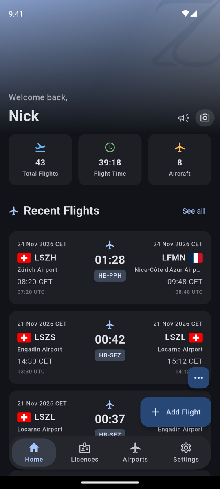
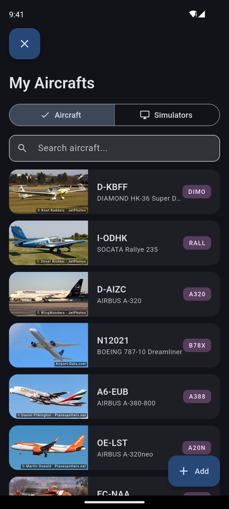
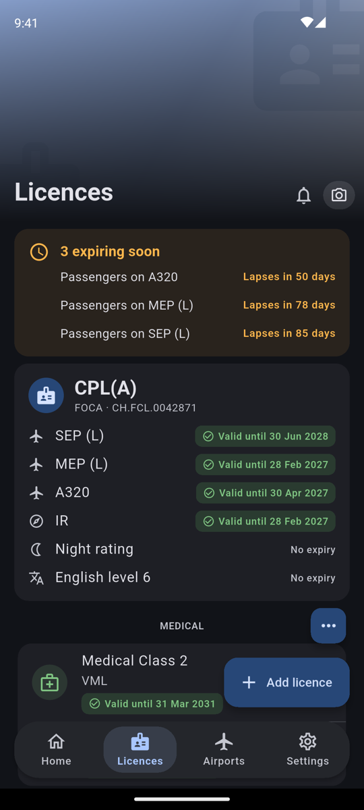
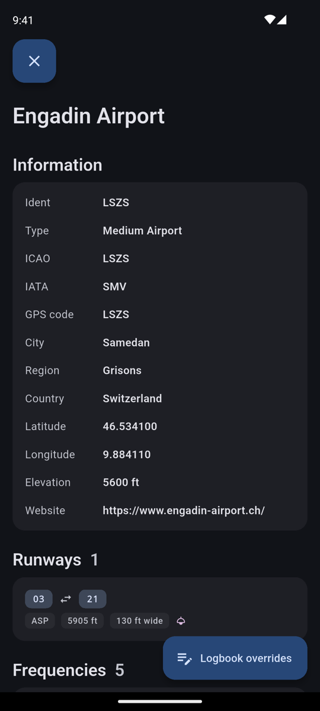
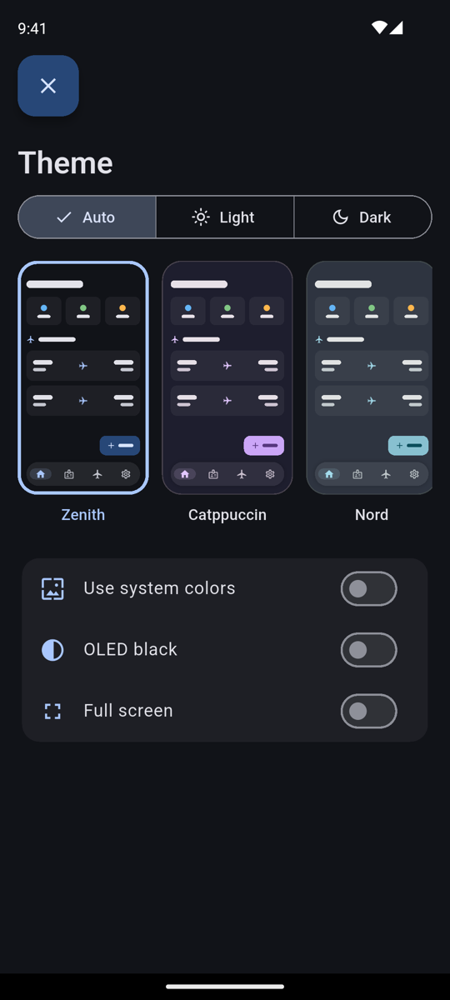
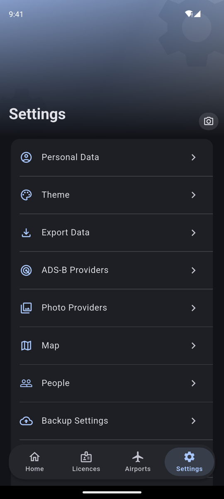

<div align="center">


# Zenith

**Your free & open-source pilot logbook**

Log flights, track currency, manage licences and aircraft, and export an EASA Part-FCL compliant logbook, all offline-first.


[](LICENSE.md)

**🚧 Zenith is still in beta and may have some bugs.** If you find one, please [report it](https://github.com/winstriker/Zenith/issues).
Dropbox and Google are still verifying Zenith's OAuth clients. Until verification is complete, Dropbox will show an alert when you log in and Google will not authorize logins.

[](iOS.md)
[](https://ko-fi.com/winstriker)

[](AI.md)

<br />






</div>

---

## ✈️ Features

### Logbook

- **Night time:** automatic night time calculation
- **Signatures:** sign remarks and endorsements right on the screen
- **Simulator sessions:** FFS, FNPT and other devices are logged separately from flight time
- **Previous experience and overrides:** bring your totals from a paper logbook
- **PDF export** in the 2026 EASA Part-FCL layout

### Capture flights automatically

- **Import from ADS-B:** pull a real track from OpenSky or FlyItalyAdsb and turn it into a logbook entry
- **Track editor:** keep only part of an ADS-B track, for example when the way there and the way back were merged into one
- **Record:** record a flight with GPS. The flight only counts once you confirm and complete it
- **Replay** any recorded or imported track on the map

### Pilot profile

- **Licences and ratings**
- **Medical certificates**
- **Currency tracking** with reminders before anything runs out
- **People:** crew members you fly with

### Aircraft and airports

- **Aircraft** look up the model online by registration and get photos from jetapi.dev, hexdb.io, adsbdb and Planespotters.net
- **Aircraft types** from online database
- **Airports:** worldwide database from OurAirports. You can add your own fields too

### Make it yours

- **Themes:** Zenith, Catppuccin and more in light or dark, Material You wallpaper colors, OLED black and full screen mode
- **Backups:** to the device, Dropbox or Google Drive, with settings for each provider
- **Cross-device sync:** keep the same logbook on all your devices through your own Dropbox or Google Drive, with no server in between
- **In-app updates:** a backup is required before each update, better be safe than sorry!
- **Announcements:** news about Zenith right in the app, you can turn them off

## 🗺️ Roadmap

The next features planned for Zenith, in no particular order:

- [ ] **Telegram backups**
- [ ] **Zenith Soar:** a new flavour of Zenith for glider pilots
- [ ] **Custom import** from airline CRMs or other logbooks
- [ ] **JSON and CSV export**
- [ ] **Other regional authorities:** use their regulations, not just EASA's, for export and currency
- [ ] **More ADS-B providers** and Flightradar24 CSV import
- [ ] **Stores**: bring Zenith on F-Droid, Play Store and App Store
- [ ] **Languages**: implement translations with i18n

Feature requests are welcome! If you need something that could be useful to other pilots too, please [open an issue](https://github.com/winstriker/Zenith/issues) describing it.

## ❤️ Support Zenith

Zenith is free and open source, with no ads, no subscriptions and no tracking. If you find it useful and want to support its development, you can leave a donation on Ko-fi.

[](https://ko-fi.com/winstriker)

Donations also help with bringing Zenith to the App Store: read [the iOS issue](iOS.md) to know more.

Can't donate? [Reporting a bug](https://github.com/winstriker/Zenith/issues) is appreciated just as much as a donation, because it makes Zenith better for everyone.

## 🚀 Getting started

Requirements: the Flutter SDK (Dart `^3.12.0`) and an Android device or emulator.

```bash
git clone https://github.com/winstriker/Zenith.git
cd Zenith
flutter pub get
flutter run
```

To regenerate the Drift database code after you change the schema:

```bash
dart run build_runner build --delete-conflicting-outputs
```

### Optional build settings

Some integrations need keys passed with `--dart-define`. Without them, the app still builds and runs, but those features won't work.

| Define                 | Used for                                                         |
| ---------------------- | ---------------------------------------------------------------- |
| `DROPBOX_APP_KEY`      | Dropbox backups and sync                                         |
| `GOOGLE_CLIENT_ID`     | Google Drive backups and sync                                    |
| `ICAO_TYPES_URL`       | ICAO aircraft type list                                          |
| `UPDATES_REPO_URL`     | In-app updates (GitHub repository URL)                           |
| `ANNOUNCEMENTS_URL`    | Announcements (base URL of the site hosting `announcements.txt`) |
| `PRIVACY_POLICY_URL`   | Privacy policy in the intro (Markdown file URL)                  |
| `TERMS_OF_SERVICE_URL` | Terms of service in the intro (Markdown file URL)                |

```bash
flutter build apk --release --flavor prod \
  --dart-define=DROPBOX_APP_KEY=... \
  --dart-define=GOOGLE_CLIENT_ID=...
```

On iOS, `GOOGLE_CLIENT_ID` must be the ID of an iOS OAuth client registered with the bundle ID of the flavor you build: `it.winstriker.zenith` for `prod`, `it.winstriker.zenithdebug` for `dev`.

`PLANESPOTTERS_CONTACT` is optional too: it's the contact URL or e-mail the app identifies itself with to online services such as Planespotters.net, and defaults to this repository. If you distribute a fork, set your own. An empty value turns Planespotters photos off.

### Build without Google Play Services

To build a fully free APK with no proprietary Google code, for example for F-Droid or phones without Google services:

```bash
flutter build apk --release --flavor prod --dart-define=DISABLE_GOOGLE_PLAY_SERVICES=true
```

Location then comes from Android's own `LocationManager` instead of Google's fused location provider. Everything works the same, but the first position fix can be slower, especially indoors.

## ⚠️ Disclaimer

THE SOFTWARE IS PROVIDED "AS IS", WITHOUT WARRANTY OF ANY KIND, EXPRESS OR IMPLIED, INCLUDING BUT NOT LIMITED TO THE WARRANTIES OF MERCHANTABILITY, FITNESS FOR A PARTICULAR PURPOSE AND NONINFRINGEMENT. TO THE EXTENT PERMITTED BY APPLICABLE LAW, IN NO EVENT SHALL THE AUTHORS OR COPYRIGHT HOLDERS BE LIABLE FOR ANY CLAIM, DAMAGES OR OTHER LIABILITY, WHETHER IN AN ACTION OF CONTRACT, TORT OR OTHERWISE, ARISING FROM, OUT OF OR IN CONNECTION WITH THE SOFTWARE OR THE USE OR OTHER DEALINGS IN THE SOFTWARE.

You are solely responsible for checking that your logbook, currency and exported documents are accurate and comply with the regulations that apply to you.

See sections 15 and 16 of the [license](LICENSE.md) for the full terms.

## 📄 License

Zenith is free software, released under the [GNU General Public License v3.0](LICENSE.md).

You may use, study, share and modify it. If you distribute a modified version, it must also be released under the GPL-3.0 with its source code available.

Third-party packages keep their own licenses. You can read them all in the app under **Settings → About → Open Source Licenses**.

## 📱 Screenshots

<table>
  <tr>
    <td align="center"><br /><sub><b>Home</b></sub></td>
    <td align="center"><br /><sub><b>Quick actions</b></sub></td>
    <td align="center"><br /><sub><b>Flight details</b></sub></td>
  </tr>
  <tr>
    <td align="center"><br /><sub><b>Aircraft</b></sub></td>
    <td align="center"><br /><sub><b>Licences & medical</b></sub></td>
    <td align="center"><br /><sub><b>Airports</b></sub></td>
  </tr>
  <tr>
    <td align="center"><br /><sub><b>Airport</b></sub></td>
    <td align="center"><br /><sub><b>Themes</b></sub></td>
    <td align="center"><br /><sub><b>Settings</b></sub></td>
  </tr>
</table>
