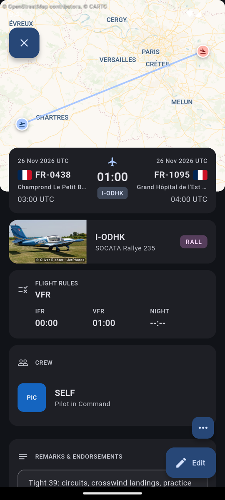
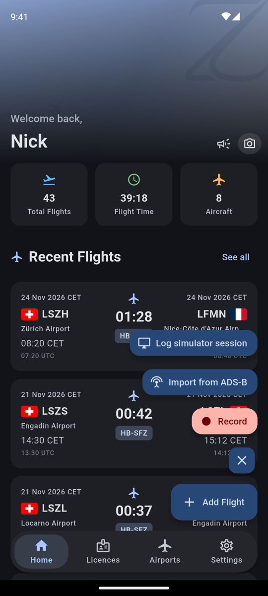
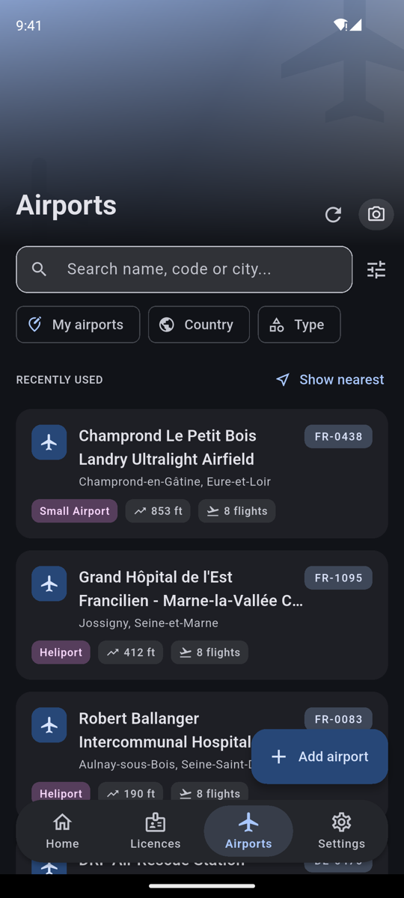

<div align="center">


# Zenith

**Your free & open-source pilot logbook**

Log flights, track currency, manage licences and aircraft, and export an EASA Part-FCL compliant logbook, all offline-first.


[](LICENSE.md)

[](iOS.md)
[](https://ko-fi.com/winstriker)

<br />





</div>

---

## ✈️ Features

### Logbook

- **Night time:** automatic night time calculation
- **Signatures:** sign remarks and endorsements right on the screen
- **Simulator sessions:** FFS, FNPT and other devices are logged separately from flight time
- **Previous experience and overrides:** bring your totals from a paper logbook
- **PDF export** in the 2026 EASA Part-FCL layout

### Capture flights automatically

- **Import from ADS-B:** pull a real track from OpenSky or FlyItalyAdsb and turn it into a logbook entry
- **Record:** record a flight with GPS. The flight only counts once you confirm and complete it
- **Replay** any recorded or imported track on the map

### Pilot profile

- **Licences and ratings**
- **Medical certificates**
- **Currency tracking** with reminders before anything runs out
- **People:** crew members you fly with

### Aircraft and airports

- **Aircraft** look up the model online by registration and get photos from jetapi.dev, hexdb.io, adsbdb and Planespotters.net
- **Aircraft types** from online database
- **Airports:** worldwide database from OurAirports. You can add your own fields too

### Make it yours

- **Themes:** Zenith, Catppuccin and more in light or dark, Material You wallpaper colors, OLED black and full screen mode
- **Backups:** to the device, Dropbox or Google Drive, with settings for each provider
- **In-app updates:** a backup is required before each update, better be safe than sorry!

## 📱 Screenshots

<table>
  <tr>
    <td align="center"><br /><sub><b>Home</b></sub></td>
    <td align="center"><br /><sub><b>Quick actions</b></sub></td>
    <td align="center"><br /><sub><b>Flight details</b></sub></td>
  </tr>
  <tr>
    <td align="center"><br /><sub><b>Aircraft</b></sub></td>
    <td align="center"><br /><sub><b>Licences & medical</b></sub></td>
    <td align="center"><br /><sub><b>Airports</b></sub></td>
  </tr>
  <tr>
    <td align="center"><br /><sub><b>Airport</b></sub></td>
    <td align="center"><br /><sub><b>Themes</b></sub></td>
    <td align="center"><br /><sub><b>Settings</b></sub></td>
  </tr>
</table>

## 🚀 Getting started

Requirements: the Flutter SDK (Dart `^3.12.0`) and an Android device or emulator.

```bash
git clone https://github.com/winstriker/Zenith.git
cd Zenith
flutter pub get
flutter run
```

To regenerate the Drift database code after you change the schema:

```bash
dart run build_runner build --delete-conflicting-outputs
```

### Optional build settings

Some integrations need keys passed with `--dart-define`. Without them, the app still builds and runs, but those features won't work.

| Define             | Used for                |
| ------------------ | ----------------------- |
| `DROPBOX_APP_KEY`  | Dropbox backups         |
| `GOOGLE_CLIENT_ID` | Google Drive backups    |
| `ICAO_TYPES_URL`   | ICAO aircraft type list |
| `UPDATES_REPO_URL` | In-app updates          |

```bash
flutter build apk --release \
  --dart-define=DROPBOX_APP_KEY=... \
  --dart-define=GOOGLE_CLIENT_ID=...
```

### Build without Google Play Services

To build a fully free APK with no proprietary Google code, for example for F-Droid or phones without Google services:

```bash
flutter build apk --release --dart-define=DISABLE_GOOGLE_PLAY_SERVICES=true
```

Location then comes from Android's own `LocationManager` instead of Google's fused location provider. Everything works the same, but the first position fix can be slower, especially indoors.

## 📄 License

Zenith is free software, released under the [GNU General Public License v3.0](LICENSE.md).

You may use, study, share and modify it. If you distribute a modified version, it must also be released under the GPL-3.0 with its source code available.

Third-party packages keep their own licenses. You can read them all in the app under **Settings → About → Open Source Licenses**.
